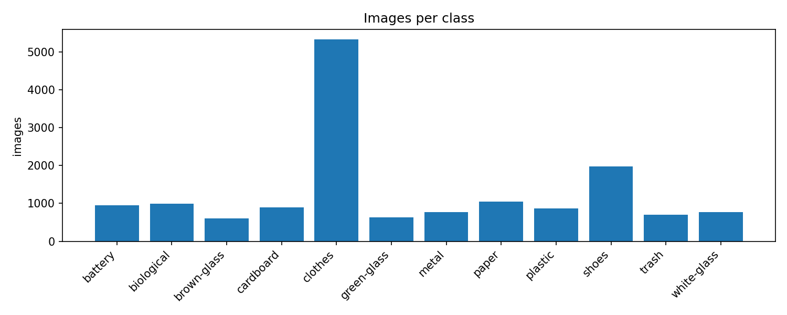
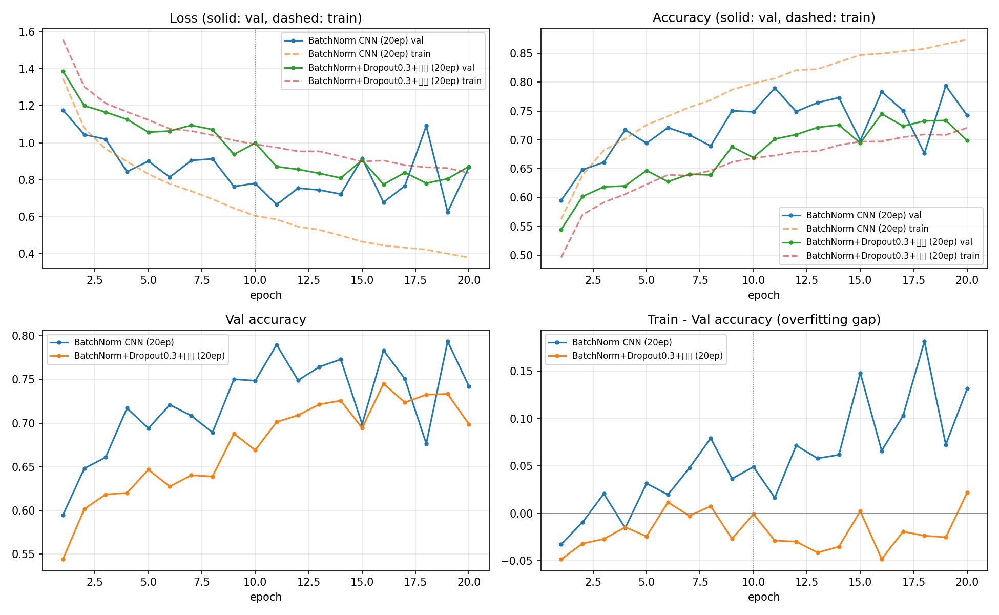
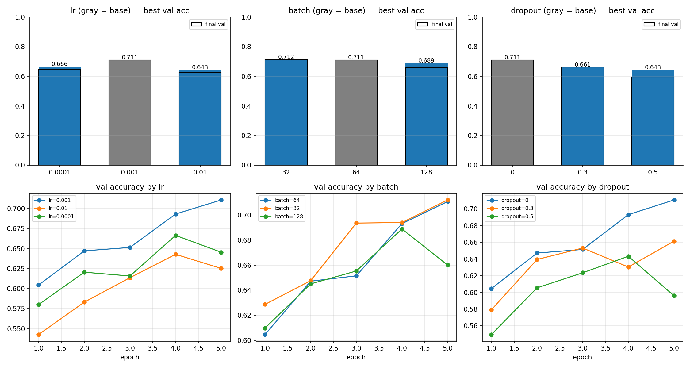
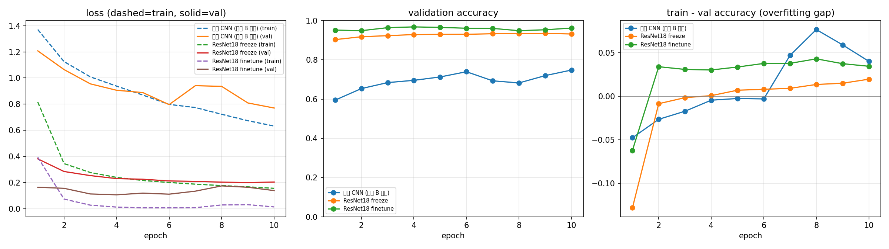
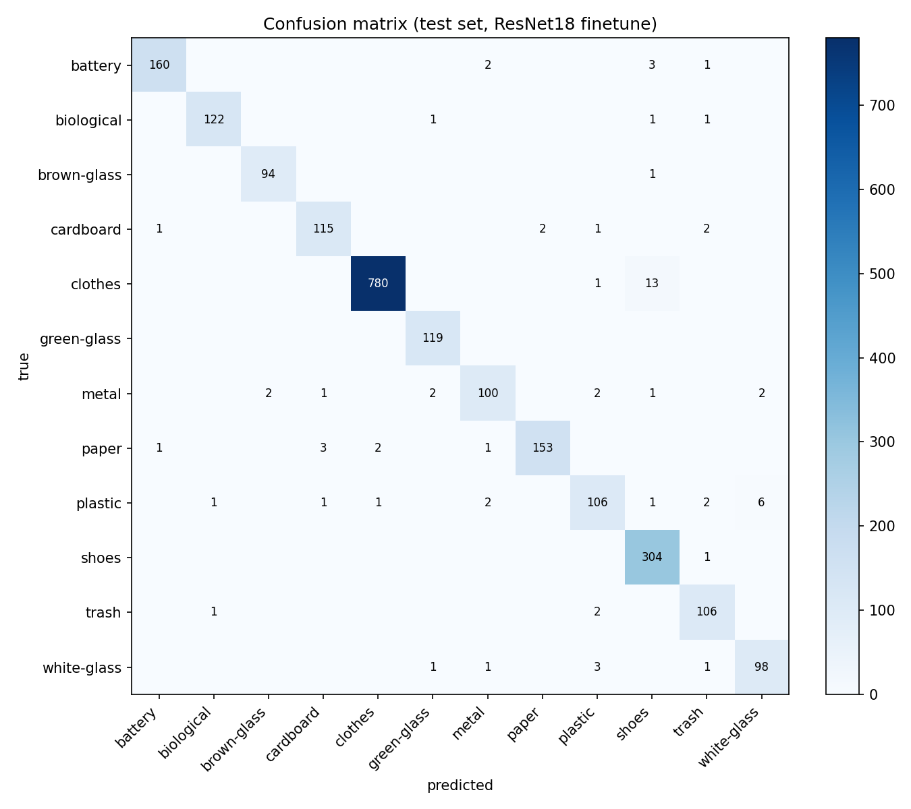

# 쓰레기 이미지 분류 — 제1회 빅데이터 프로그래밍 해커톤

 ← 학습된 모델로 바로 사진 예측해 보기 (약 1~2분)

PyTorch로 쓰레기 사진을 12개 클래스로 분류하는 모델을 만들었습니다. 수업 8~10주차 내용(CNN, 과적합 대응, 데이터 증강, 하이퍼파라미터 비교, 전이학습)만 사용했습니다.

**최종 모델: ResNet18 finetune · 테스트 정확도 0.9695 (2,257 / 2,328장)**

---

## 1. 데이터

| 항목 | 내용 |
|---|---|
| 데이터셋 | [Kaggle — Garbage Classification (mostafaabla)](https://www.kaggle.com/datasets/mostafaabla/garbage-classification) |
| 클래스 (12) | battery, biological, brown-glass, cardboard, clothes, green-glass, metal, paper, plastic, shoes, trash, white-glass |
| 전체 | 15,515장 |
| 분할 | 학습 10,860 / 검증 2,327 / 테스트 2,328 (70 / 15 / 15, 시드 42) |
| 입력 | 224×224, ImageNet 평균·표준편차로 정규화 |
| 증강 | RandomResizedCrop(scale 0.7~1.0), RandomHorizontalFlip, RandomRotation(15) |

테스트셋은 모든 모델 선택이 끝난 뒤 **섹션 6에서 한 번만** 사용했습니다.

---

## 2. 실험과 결과

### 실험 A — 과적합 대응과 데이터 증강 (10 epoch)
9주차 `05_experiment`처럼 한 번에 한 가지만 바꿔 네 모델을 비교했습니다.

| 모델 | 학습 정확도 | 검증 정확도 | 차이(학습−검증) | 검증 손실 |
|---|---|---|---|---|
| 기본 CNN | 0.6858 | 0.7000 | −0.0142 | 0.894 |
| Dropout CNN (0.5) | 0.5943 | 0.6498 | −0.0555 | 1.088 |
| **BatchNorm CNN** | 0.7964 | **0.7331** | +0.0633 | 0.804 |
| 데이터 증강 CNN | 0.6720 | 0.6541 | +0.0179 | 0.994 |

같은 설정으로 세 번 학습했을 때 BatchNorm CNN의 검증 정확도는 0.721 / 0.744 / 0.733으로, GPU 연산의 비결정성 때문에 실행마다 1~2%p 달라졌습니다. 표의 값은 노트북에 출력된 마지막 실행 결과입니다.

### 실험 3-5 — 과적합 확인 (20 epoch)
10 epoch에서는 과적합이 나타나기 전이라, epoch을 20으로 늘려 다시 비교했습니다.

| 모델 | 차이 (epoch 10 → 20) | 검증 손실 (epoch 10 → 20) |
|---|---|---|
| BatchNorm CNN | +0.049 → **+0.132** | 0.78 → **0.87 (상승)** |
| BatchNorm + Dropout 0.3 + 증강 | −0.001 → +0.022 | 1.00 → 0.87 (하락) |

규제가 없는 모델은 10 epoch 이후 과적합이 진행되었고, 세 기법을 조합한 모델은 학습−검증 차이를 작게 유지했습니다.

### 실험 B — 하이퍼파라미터 비교 (BatchNorm CNN, 5 epoch)
기준값(lr 1e-3, batch 64, dropout 0)에서 한 항목씩만 바꿨습니다. 값은 최고 검증 정확도입니다.

| 항목 | 후보별 결과 | 최적 |
|---|---|---|
| 학습률 | 1e-4: 0.667 / **1e-3: 0.711** / 1e-2: 0.643 | 1e-3 |
| 배치 크기 | **32: 0.712** / 64: 0.711 / 128: 0.689 | 32 (64와 사실상 동률) |
| Dropout | **0: 0.711** / 0.3: 0.661 / 0.5: 0.643 | 0 |

### 실험 C — 전이학습 vs 직접 만든 CNN (10 epoch)

| 모델 | 검증 정확도 | epoch 1 검증 | 학습 파라미터 | 학습 시간 |
|---|---|---|---|---|
| 직접 CNN (실험 B 최적) | 0.7482 | 0.59 | 134,540 | 9.1분 |
| ResNet18 freeze (fc만 학습) | 0.9321 | 0.90 | 6,156 | 8.4분 |
| **ResNet18 finetune (전체, lr 1e-4)** | **0.9622** | **0.95** | 11,182,668 | 10.3분 |

finetune은 1 epoch에서 이미 0.95로, 직접 CNN의 10 epoch 결과(0.75)를 넘었습니다.

### 최종 평가 — 테스트셋 (1회)

| 검증 정확도 | 테스트 정확도 | 차이 |
|---|---|---|
| 0.9622 | **0.9695** | −0.0073 |

클래스별로 green-glass(1.000)와 shoes(0.997)가 가장 높고, plastic(0.883)과 metal(0.909)이 가장 낮았습니다. plastic과 white-glass는 서로 9건 헷갈렸습니다(투명한 재질).

---

## 3. 새 이미지 예측

위의 **Open in Colab** 버튼을 누르고 셀을 위에서부터 실행하면, 학습된 모델을 자동으로 내려받아 업로드한 사진을 예측합니다. 학습은 다시 하지 않습니다.

- 학습된 모델 파일: [Releases v1.0 — best_model.pt](https://github.com/Ehtel-crypto/KmubigdataTRASH/releases/tag/v1.0) (약 45MB)
- GPU, Kaggle 로그인, Google Drive 연결이 필요 없습니다.

---

## 4. 저장소 구성

| 파일 | 내용 |
|---|---|
| `garbage_classification.ipynb` | 전체 과정 (섹션 0~8), 실행 결과 포함 |
| `predict_demo.ipynb` | 학습된 모델로 사진 예측만 하는 노트북 |
| `results/` | 실험별 표(csv)와 그래프(png) |
| `results/best_model_info.json` | 최종 모델 정보 (클래스 이름, 입력 크기, 정규화 값, 테스트 정확도) |
| `prompts.md` | 생성형 AI 사용 프롬프트 기록 |

### 메인 노트북을 처음부터 다시 실행하려면
1. Colab에서 `garbage_classification.ipynb`를 열고 **런타임 → 런타임 유형 변경 → T4 GPU** 선택
2. 위에서부터 차례로 실행 (데이터는 `kagglehub`로 자동 다운로드, 결과는 Google Drive `MyDrive/garbage_hackathon/results/`에 저장)
3. 전체 학습에 약 2시간 걸립니다. 이미 저장된 결과가 Drive에 있으면 학습을 건너뛰고 불러옵니다.

---

## 5. 한계
- plastic과 metal의 정확도가 가장 낮고, 투명 플라스틱 컵 사진을 white-glass로 잘못 예측하는 경우가 있었습니다.
- 클래스 불균형(clothes가 다른 클래스보다 훨씬 많음)을 따로 보정하지 않았습니다.
- 모든 실험을 시드 하나로 한 번씩만 돌렸습니다. GPU 비결정성 때문에 같은 설정에서도 ±2% 정도 달라질 수 있습니다.
- 사진 한 장에 클래스 하나만 출력하므로, 여러 물건이 섞인 사진은 각각 판별할 수 없습니다.

---

## 6. 사용 도구와 참고 자료
- PyTorch, torchvision(`ImageFolder`, `transforms`, `models.resnet18`), matplotlib, numpy, pandas. YOLO 등 객체 탐지·분류 패키지는 사용하지 않았습니다.
- 수업 자료: [빅데이터프로그래밍 GitHub](https://github.com/zoomer1975-boop/bigdata) 8~10주차
- 사전학습 모델: torchvision ResNet18 (ImageNet 가중치)
- 생성형 AI: Claude (Anthropic) — 사용한 프롬프트는 [`prompts.md`](prompts.md)에 기록
